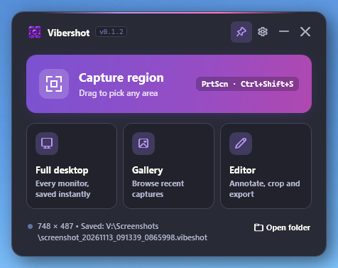
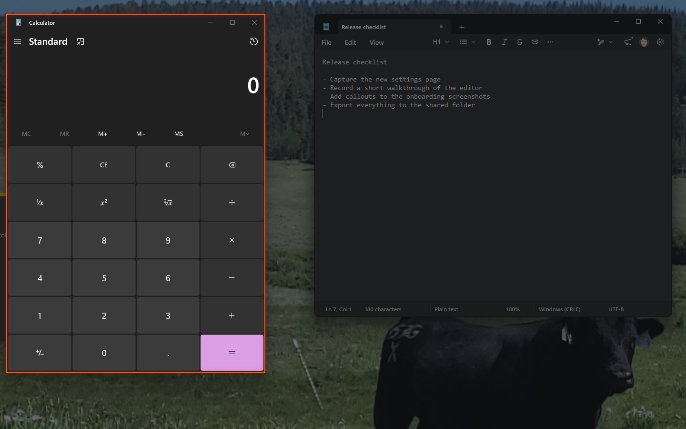
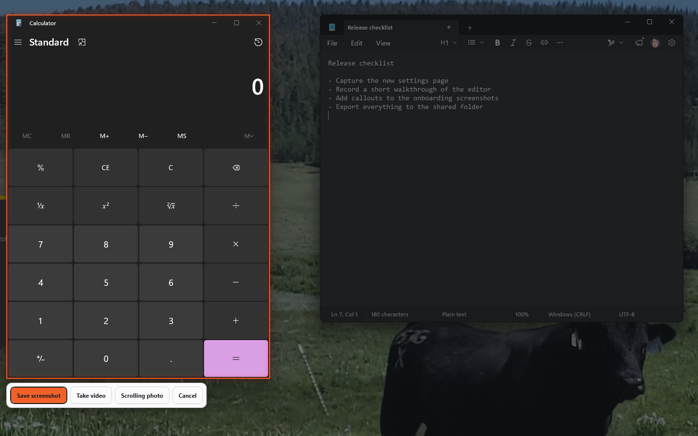
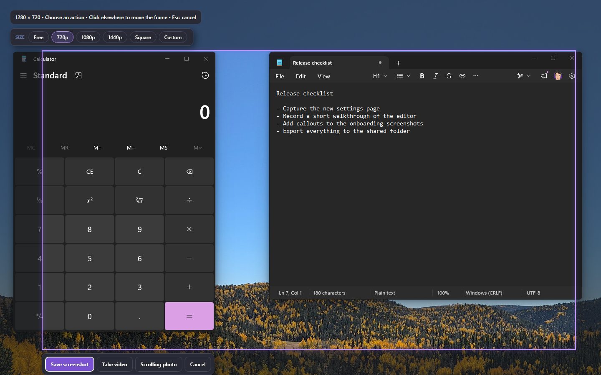
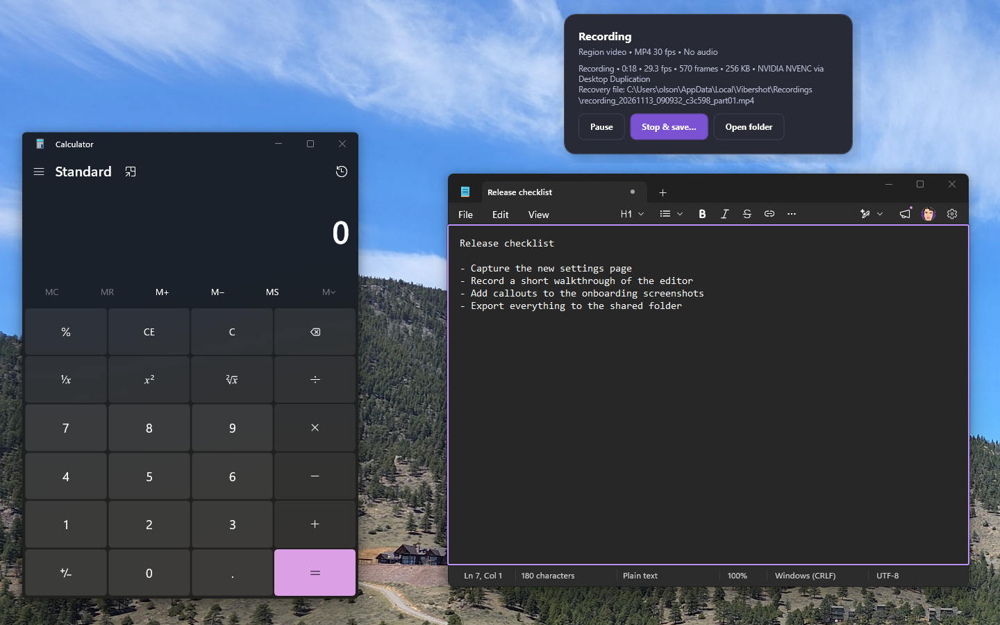
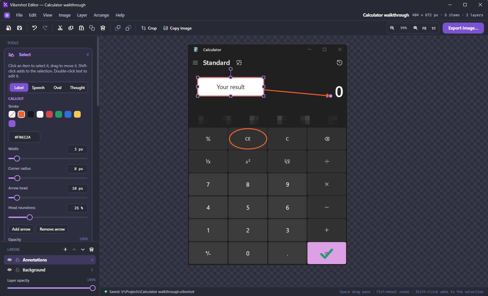
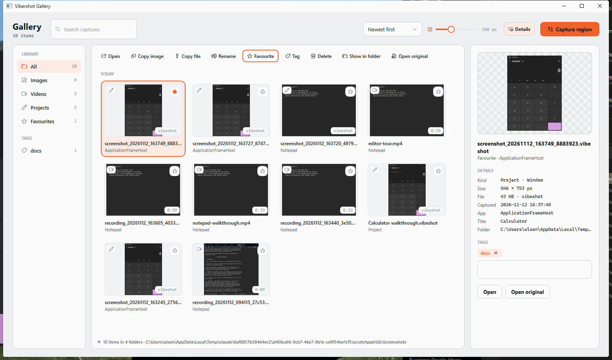

# Vibershot

**Screenshots, screen recordings and annotations for Windows 11, without the clutter.**

Vibershot is a small, fast capture tool. Press a key, pick what you want on screen, and it is saved, copied, recorded or opened for editing. Everything you capture lands in a searchable gallery, and nothing you draw on a picture is ever baked in until you export it.

<br clear="all">



## Why Vibershot

- **One key, any part of the screen.** Print Screen or Ctrl+Shift+S opens the capture tool over whatever you are looking at.
- **Smart selection.** Hover and Vibershot outlines the window, panel or page content under the cursor. Click to take it, or drag your own region.
- **Still or moving.** The same selection becomes a screenshot, an MP4 recording or a stitched scrolling capture.
- **Exact sizes when you need them.** Pick 720p, 1080p, 1440p, square or a custom frame and place it with a click.
- **Edit without losing anything.** Arrows, shapes, text, callouts, stamps, crops and layers stay editable in the Vibershot project format.
- **Hide what is private.** Blur or pixelate part of a picture; the hidden pixels are really gone from the export.
- **A home for every capture.** The gallery keeps everything, with search, tags and favourites.
- **Lightweight.** A native Windows app with a dark theme that sits in the tray and does nothing until you ask it to.

## Capture any region

Press the hotkey and move the mouse. Windows and app content light up as you pass over them, so grabbing a dialog, a browser page or a panel is a single click. Hold Shift to take the whole window frame, or drag to mark out exactly the area you want.



Once you have a selection, choose what happens next: save a screenshot, record the area as a video, or build a scrolling capture one shot at a time. Press Esc at any point to cancel. **Full desktop** grabs every monitor at once, including multi-monitor layouts.



Need an exact size? The **Size** bar at the top of the capture tool swaps the free selection for a fixed frame: 720p, 1080p, 1440p, square, or a custom width and height that Vibershot remembers. The frame follows the pointer; click to place it, and click again elsewhere to move it.



After a capture, Vibershot does what you have told it to: save to the library, copy to the clipboard, open the editor, open the gallery, or just show a small preview with **Copy**, **Save as…** and **Edit**. Presets switch between "quick copy", "save to library", "save and edit" and "save and review" in one click.

## Record video

Choose **Take video** and the selected region is recorded as an H.264 MP4 at the frame rate you pick, using your GPU's hardware encoder when one is available. A thin outline marks the recorded area and never appears in the footage, and the control panel shows live frame rate, elapsed time and file size. Pause and resume as often as you like. Recordings are written in a crash-safe format while they run, so an unexpected shutdown still leaves a playable file.



## Annotate in the editor

Captures open in a layered editor. Every command is in the menu bar, the common ones sit on the action rail, and each tool is a labelled row on the left that opens its own options when you pick it.



- **Arrows, shapes and text.** Arrows with sharp or rounded heads, rectangles, ellipses, lines and text, each with stroke, fill, opacity and drop shadow. Every slider has a number box beside it for values past the slider's range.
- **Callouts.** A label with one or more arrows, or a speech, oval or thought bubble. Drag from the thing you are pointing at to where the note should sit, then type.
- **Stamps.** Ticks, crosses, pointers, stars, warnings and more in a searchable grid. Click to place one or drag to size it.
- **Blur and pixelate.** Paint with a brush or drag a box over anything that should not be readable, or blur a marquee selection.
- **Canvas and size.** Start from a blank canvas, add or trim space on any side, scale the whole picture, or crop without throwing pixels away.
- **Layers.** Items live on layers that can be hidden, locked, reordered and faded. Marquee-select pixels to lift, move, copy or clear them.

Nothing is final: anything you add can be selected, moved and restyled later, and undo and redo cover every step.

Save as a **Vibershot project** (`.vibeshot`) to keep text, shapes and layers editable, or **Export** a flat PNG, JPEG or WebP with a live preview of the compression result. **Copy image** puts the finished picture on the clipboard for pasting anywhere.

## Edit recordings

Open an MP4 from the gallery to cut it up on a layered timeline: trim either end of a clip, split at the playhead or with the razor, drag clips along the timeline and between layers, and stack one video over another. Add pictures (PNG, JPEG, BMP, WebP) as well, and place any video or picture right in the preview: drag it to move, drag its handles to resize or turn it, crop its edges, and set how see-through it is. Audio lanes show a waveform, and a video's sound can be detached and edited on its own. The **Elements** tab holds text, titles, lower thirds, callouts, shapes, arrows and stamps: drag one onto the picture or the timeline, double-click text to type in place, and restyle it in the panel. **Caption** (T) adds a caption at the playhead on its own track; captions import from and export to `.srt` files, and are drawn into the exported video. Projects save as `.vibevideo` files that link to your original MP4s, and **Export MP4** renders the result at up to 4K. Large files preview from low-resolution proxies so scrubbing stays quick; the export always uses the originals.

## Find it again in the gallery
Every capture saved to the library shows up in the gallery, grouped by day, with the app and window it came from. Filter by images, videos, projects or favourites, search by file name, app, window title or tag, and sort by date, name or size. Rename, tag, favourite, copy or delete from the keyboard. Drag tiles out to other apps, or drop files in to import them. Drag the dividers to resize the side rail and the details pane; a wider pane shows a larger preview. The gallery can stay open as a home base: **Capture region** in its header starts a new capture and shows the result selected.



Old screenshots and recordings can be moved to the Recycle Bin automatically after a number of days you choose. The library is a plain folder of files, so it works with Explorer, backups and sync tools.

## Install

1. Download `VibershotSetup-<version>.exe` from the [latest release](https://github.com/CommonDocsOrg/vibershot/releases/latest).
2. Run it. The installer works per user and needs no administrator rights. It asks where your library should live and whether to start with Windows.
3. Press **Print Screen** or **Ctrl+Shift+S** and capture something.

Vibershot is self-contained: nothing else needs to be installed. It checks for updates once a day and can download and install a new version in place.

Requires Windows 11 (Windows 10 version 2004 or later also works).

## Default shortcuts

| Action | Shortcut |
|---|---|
| Capture a region or window | Print Screen, Ctrl+Shift+S |
| Full desktop | Set in Settings → Hotkeys |
| Record video | Set in Settings → Hotkeys |
| Open the gallery | Set in Settings → Hotkeys |
| Open the editor | Set in Settings → Hotkeys |

Every shortcut can be changed in Settings. If you would rather keep Print Screen for Windows, turn the takeover off there.

In the editor, one letter picks each tool:

| Tool | Key | Tool | Key |
|---|---|---|---|
| Select | V | Text | T |
| Marquee | M | Callout | O |
| Crop | C | Stamp | K |
| Arrow | A | Blur | B |
| Shape | S | Image | I |

Ctrl+N opens a new canvas, Ctrl+S saves the project, Ctrl+E exports an image and Ctrl+0 shows the picture at actual size.

## Build from source

Vibershot is a C# / .NET 10 / WPF application. With the .NET 10 SDK installed:

```powershell
.\run.ps1
```

This builds the app, fetches the FFmpeg binaries used for MP4 recording and starts Vibershot. See [docs/DEVELOPMENT.md](docs/DEVELOPMENT.md) for the project layout, settings reference and manual test checklist, and [docs/RELEASING.md](docs/RELEASING.md) for building the installer and publishing a release.

## License

Vibershot is free software released under the [GNU General Public License v3.0](LICENSE). MP4 recording uses a separately downloaded FFmpeg build; its licence ships alongside it.
